# Product Design 점검 · 청모와 모바일 청첩장

2026-10-12. 실제 로컬 화면과 브라우저 상호작용을 근거로 한 UX·접근성 점검. 기존 크림·테라코타·그린 색상과 한국어 모바일 흐름을 유지하며 확인된 문제를 수정한다. 새로운 제품 화면이나 외부 배포는 추가하지 않는다.

## 1. 청모 목록 · 양호, 이동 표시 개선
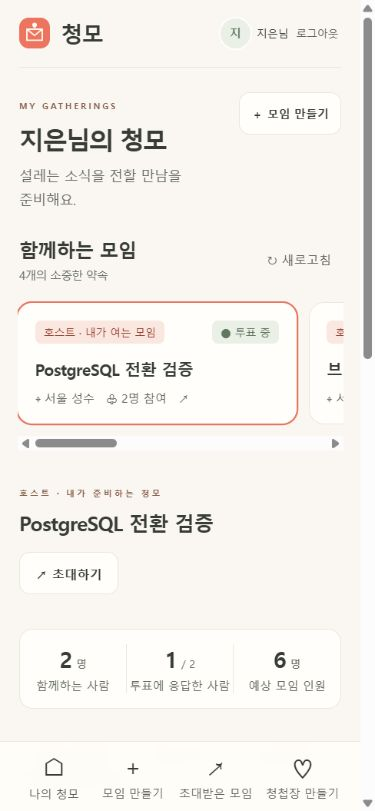
모임 상태와 호스트 역할을 구분하는 카드, 하단 4개 메뉴가 보인다. 카드가 수평으로 이어지는 것은 다음 모임을 암시하지만 스크롤바가 눈에 띄고 현재 선택과 하단 메뉴의 선택 상태를 더 명확히 할 수 있다. 터치 목표와 작은 메타 글씨의 대비를 보강한다.

## 2. 투표 · 양호, 고정 요소 간격 점검
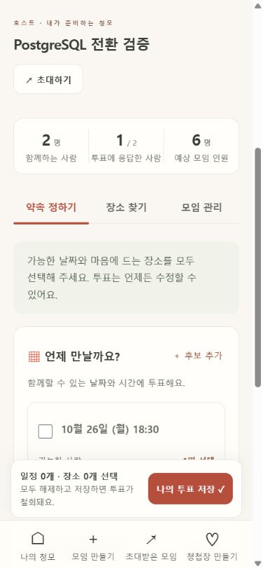
날짜·장소 후보, 안내, 하단 저장 요약이 명확하다. 고정 저장 바와 모바일 메뉴가 화면 일부를 차지하므로 안전 여백·작은 화면·키보드 탐색을 함께 확인한다. 모임 선택 버튼이 aria-pressed 때문에 체크박스로 노출되는 점은 보조기술에서 혼동될 여지가 있다(구현 검사 필요).

## 3. 게스트 참여 · 양호, 코드 입력 다듬기
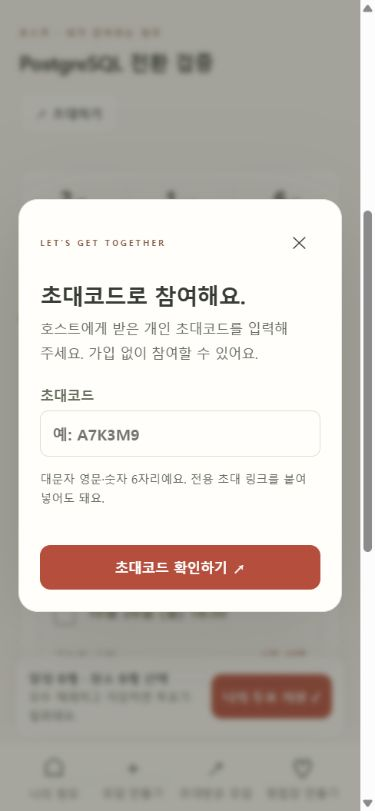
가입 없이 참여한다는 안내와 단일 확인 버튼이 명확하다. 대문자 코드·링크를 받으므로 입력 시 코드 문자는 자동 정리하되 URL 붙여넣기는 유지해야 한다. 실제 게스트 세션 생성·코드 만료는 이번 화면 점검에서 진행하지 않았다.

## 4. 청첩장 제작 진입 · 개선 필요
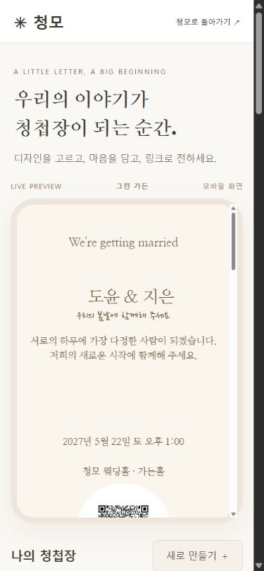
표지 미리보기가 첫 모바일 화면을 대부분 차지한다. 템플릿과 편집 입력은 화면 아래에 있어 사용자가 시작 위치를 찾기 어렵다. 기본 정보·사진·자유 편집·공유를 단계로 묶고 모바일에서는 편집부터 보여준다. 미리보기는 명시적 전환 버튼으로 바로 열 수 있게 한다. 기존 미리보기에서는 QR 일부가 잘려 보인다.

## 5. 자유 편집과 저장 · 개선 필요
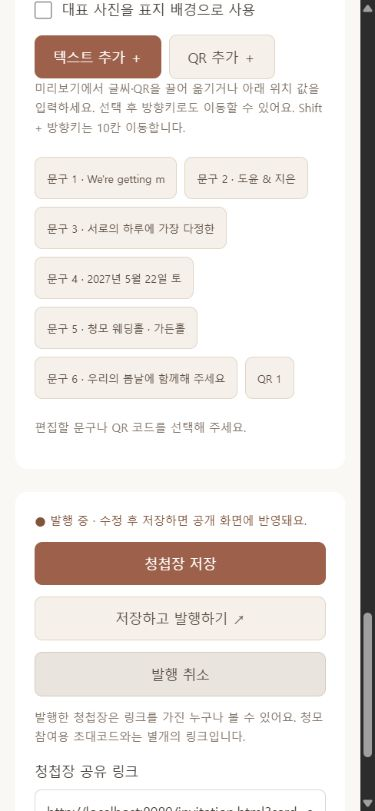
폰트·배경·텍스트·QR 목록까지 여러 화면을 스크롤해야 하며, 설정을 바꾸는 동안 미리보기가 화면 밖에 있다. 같은 화면에서 편집/미리보기를 전환하고 항상 접근 가능한 저장 버튼을 제공한다. 문구 선택·QR 선택의 활성 상태, 필드 레이블, 저장 후 알림 수명·초점도 개선 대상이다. 토스트와 저장 위치 문제는 구현과 브라우저 상호작용으로 추가 확인한다.

## 6. 공개 청첩장 · 시각적으로 양호, 접근성 개선

폰트와 표지 배치, QR 렌더링이 보인다. 호스트가 정한 공백·배치는 유지한다. SVG 표지가 일반적인 이름만 보조기술에 전달하므로 실제 문구와 QR 연결 목적을 읽을 수 있도록 보강한다. 추가로 이미지 확대 열람과 연락·일정·지도 버튼의 터치 영역을 점검한다.

## 한계
스크린샷만으로 WCAG 준수를 판단하지 않는다. 색 대비·레이블·읽기 순서·초점은 코드와 브라우저로 확인하고, 실제 스크린리더·휴대폰 카메라·소셜 인증 제공자 화면은 미검증으로 구분한다. 예제 청첩장 배치와 데이터는 디자인 개선으로 덮어쓰지 않는다.

## 개선 방향
1. 기존 디자인 언어를 공유하는 짧은 제작 헤더와 단계 탐색.
2. 편집을 우선하는 모바일 화면, 즉시 미리보기 전환, 고정 저장 동작.
3. 글자·QR 선택과 편집 상태를 명확히 표시하고 키보드 초점을 유지.
4. 주요 메뉴의 현재 위치·터치 목표·레이블을 정돈하고 코드 입력 안내 개선.
5. 공개 SVG의 의미·QR 목적을 보조기술에도 전달.

## 개선 후 결과

| 단계 | 상태 | 확인한 개선 |
|---|---|---|
| 1. 청모 목록 | 양호 | 메뉴 아이콘과 현재 위치, 수평 카드 탐색 정돈 |
| 2. 투표 | 양호 | 실제 선택과 구분되는 모임 버튼 의미, 고정 저장 바·메뉴 간격 |
| 3. 게스트 참여 | 양호 | a7 k3 m9 입력이 A7K3M9로 정리됨, 링크 붙여넣기 유지 |
| 4. 청첩장 제작 | 개선 완료 | 모바일 편집 우선, 5개 단계 탐색, 항상 접근 가능한 저장 |
| 5. 자유 편집 | 개선 완료 | 선택 항목으로 이동, 편집·미리보기 전환, 저장 상태와 초점 |
| 6. 공개 청첩장 | 개선 완료 | 실제 표지 문구·QR 목적 노출, QR 링크를 직접 누를 수 있음 |
| 7. 사진 확대 | 정상 | 사진 확대와 닫기, 닫은 뒤 사진 버튼으로 초점 복귀 |

자동 테스트 32개 통과. 모바일 390px와 데스크톱 1280px에서 가로 넘침 없음. 빈 초안 저장은 예식 정보 단계의 신랑 이름으로 이동하고 오류를 안내하며 DB에 저장하지 않음. 기존 청첩장 저장 전후 공개 본문 SHA-256이 동일해 디자인·사진·배치를 보존했음을 확인. 공개 문서의 h1 1개와 QR 링크 1개 확인. 실제 스크린리더 테스트는 미실시.

| 단계 | 개선 전 | 개선 후 |
|---|---|---|
| 1. 청모 목록 |  | 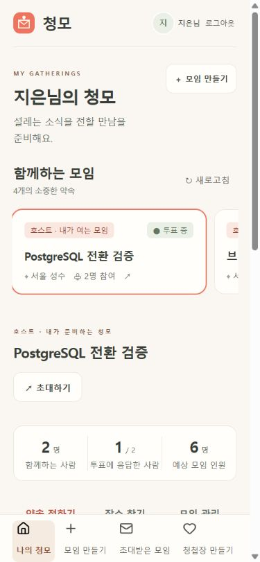 |
| 2. 투표 |  | 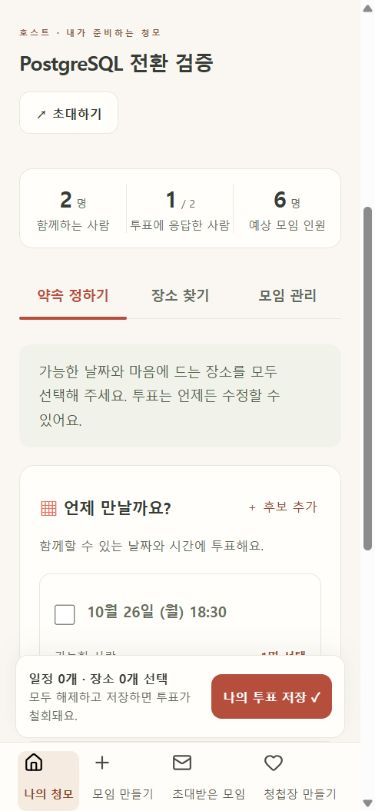 |
| 3. 게스트 입력 |  | 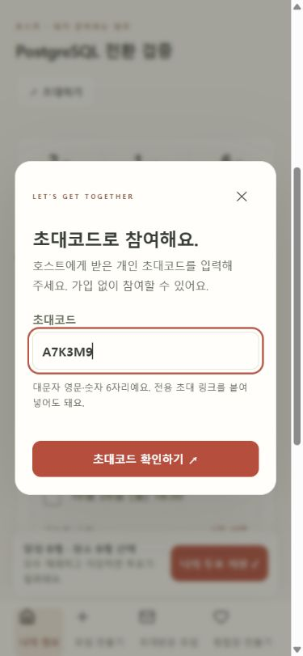 |
| 4. 제작 진입 |  | 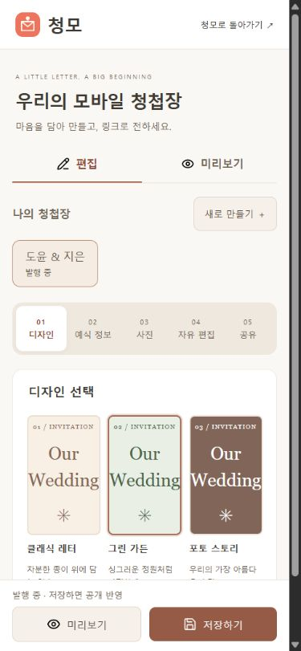 |
| 5. 자유 편집 (전: 목록, 후: QR 선택) |  | 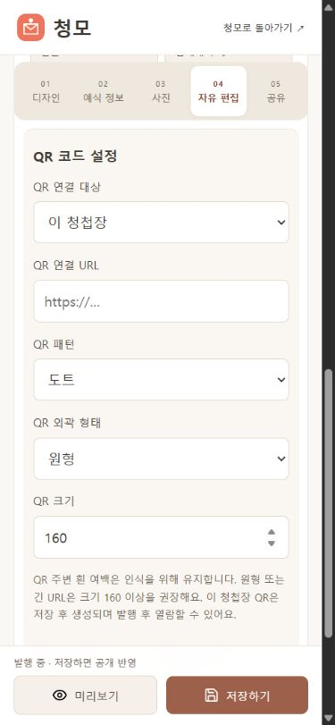 |
| 6. 공개 청첩장 |  | 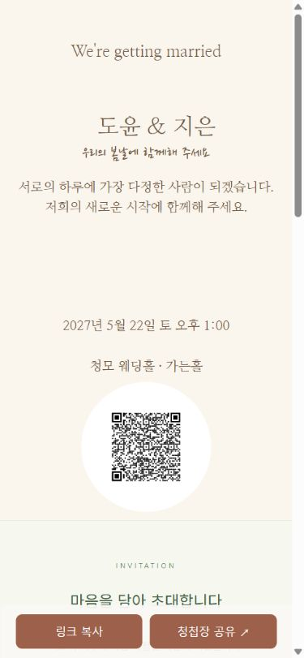 |

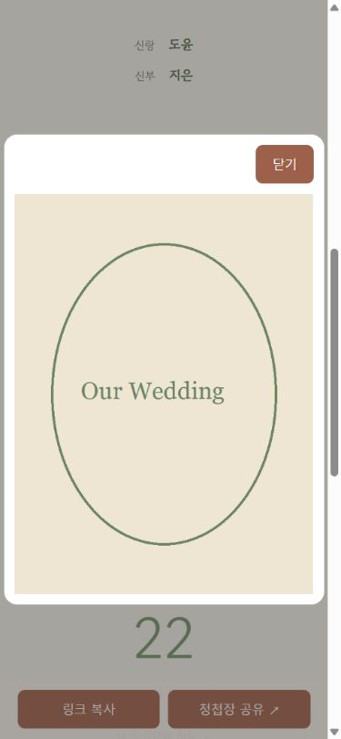

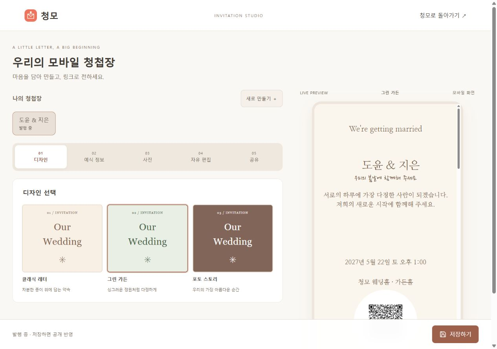

아이콘은 Lucide 원본을 자체 호스팅하며 경로 형태를 수정하지 않았다. 라이선스는 src/main/resources/static/icons/LICENSE.txt에 포함한다.
