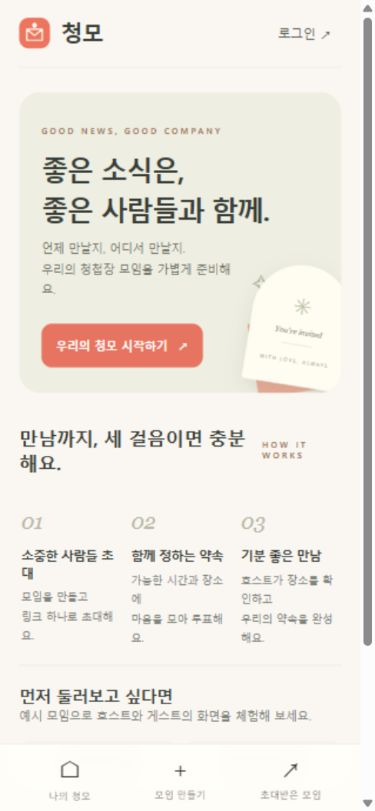
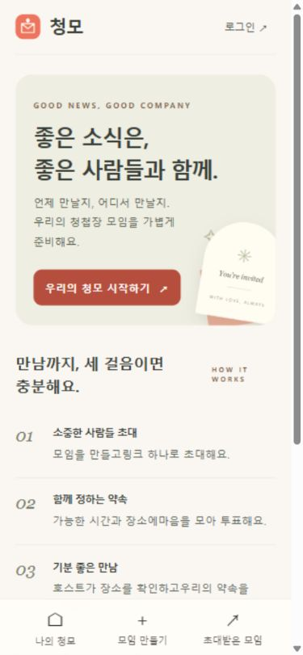
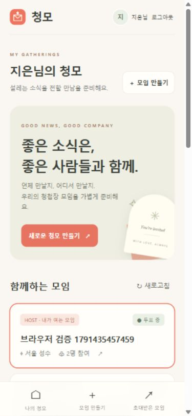
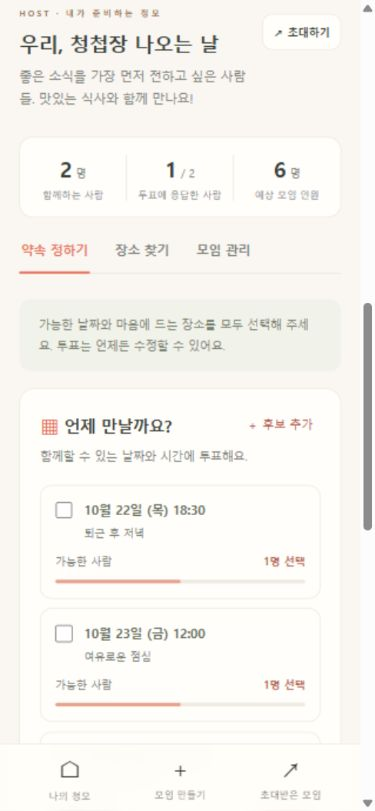
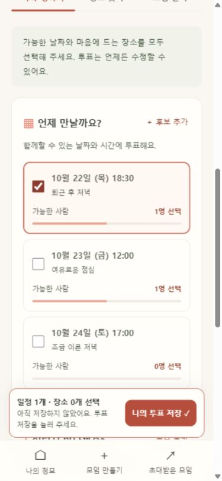
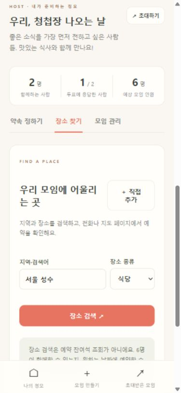
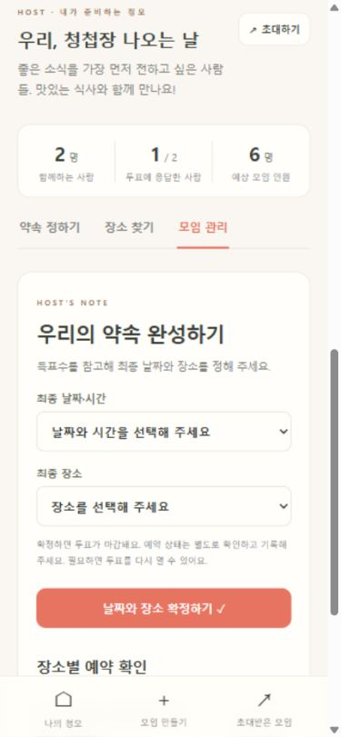
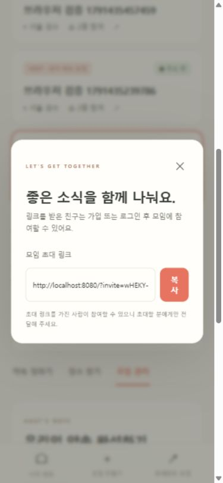
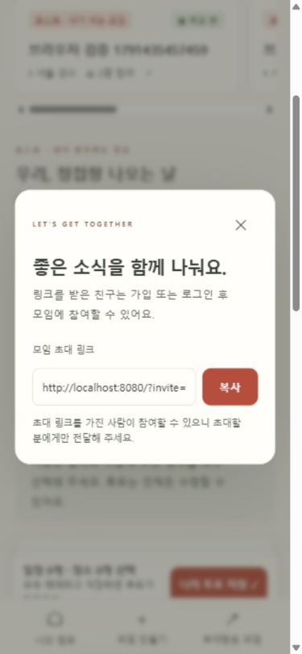
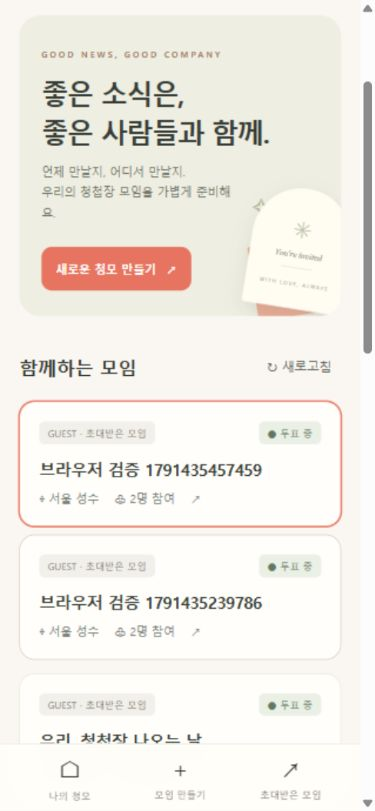

# 청모 디자인 점검 및 개선 — 2026-10-08

Product Design audit 스킬로 현재 로컬 사이트를 직접 열어 모바일 화면을 캡처하고 수정했다. 기존 아이보리·코랄·세이지 색감과 서비스 기능을 유지하면서 모임 선택, 투표 저장, 초대의 마찰을 줄였다.

## 점검 단계와 결과

| 단계 | 화면 | 발견 사항 | 개선 후 상태 |
|---|---|---|---|
| 1 | 시작 안내 | 좁은 3열에서 한글 줄바꿈과 작은 설명 | 모바일 세로 안내와 큰 설명으로 개선 |
| 2 | 호스트 목록 | 로그인 후 큰 소개 영역 반복, h1 중복 | 소개 제거, 모임 가로 목록, h1 하나 |
| 3 | 투표 | 저장 버튼이 긴 목록 끝에 위치 | 하단 저장 영역, 선택 개수·미저장 상태, 탭 간 선택 유지 |
| 4 | 장소 찾기 | 제목과 직접 추가 버튼이 폭을 나눠 줄바꿈 | 모바일 세로 제목·버튼 배치; 실제 검색은 미검증 |
| 5 | 모임 관리 | 작은 폼 글자와 예약 버튼 대상 불명확 | 16px 입력, 대상명을 포함한 접근성 이름, 키보드 탭 이동 |
| 6 | 초대 | 복사 버튼 글자가 세로로 끊김, dialog 이름 없음 | 버튼 최소 폭, 제목과 dialog 연결, Escape 닫기 확인 |
| 7 | 게스트 | 관리 탭은 잘 분리됐으나 목록 진입이 길었음 | 공통 목록 개선 적용; 게스트 권한 분리는 유지 |

## 점검 증거

현재 점검에서 직접 캡처하고 저장된 파일을 열어 확인했다. 로딩 화면과 저장 영역이 과도하게 커졌던 중간 결과는 최종 증거에서 제외했다.

### 1. 시작 안내

### 2. 호스트 목록

### 3. 투표

### 4. 장소 찾기

### 5. 모임 관리

### 6. 초대

### 7. 게스트

게스트의 호스트 관리 탭 제외를 DOM과 화면에서 확인했다. 개선 후 게스트 로그인은 진행했으나 사용자 미리보기 요청으로 별도 최종 게스트 캡처는 완료하지 않았다.

## 검증과 한계

빌드 성공, 서버 통합 테스트 10개 통과. 내장 브라우저에서 복수 투표, 탭 이동 후 미저장 선택 유지, 저장 후 안내, 철회, 방향키·Home 탭 이동, dialog 이름·Escape 닫기를 확인했다. 시험 투표는 철회해 기존 예시 모임의 표를 복원했다.

360/390/768/1280px에서 문서 가로 넘침 없음, 로그인 화면 h1 하나, 모바일 저장 영역 높이 약 74–87px를 확인했다. 결과는 `artifacts/design-audit/viewport-checks.json`에 있다. 작은 보조 글자와 주 버튼의 대비를 강화하고 주요 조작 최소 높이를 44px로 조정했다.

화면만으로 전체 접근성 준수를 보장하지 않는다. 실제 기기의 화면 읽기 도구, 소프트 키보드, 확대·고대비 모드, 실제 장소 검색·예약 재고, 일반 사용자 사용성 평가는 미검증이다. 하단 저장 영역은 투표 폼 안에서만 고정되고 폼 밖에서는 표시되지 않는다. 모바일 모임 목록은 가로 스크롤 방식이다.

로컬 서버는 사용자 미리보기 요청 후 백그라운드 프로세스로 실행했다. [사이트 보기](http://localhost:8080).
