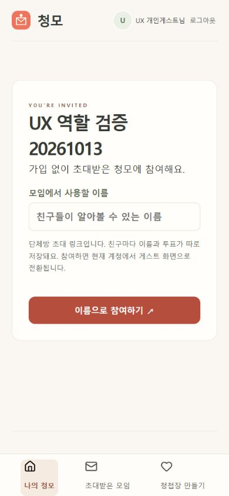
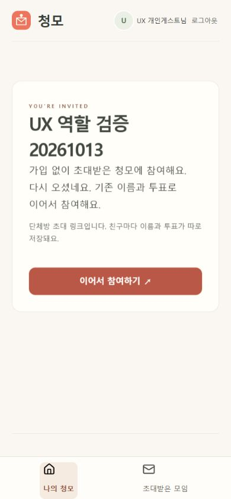
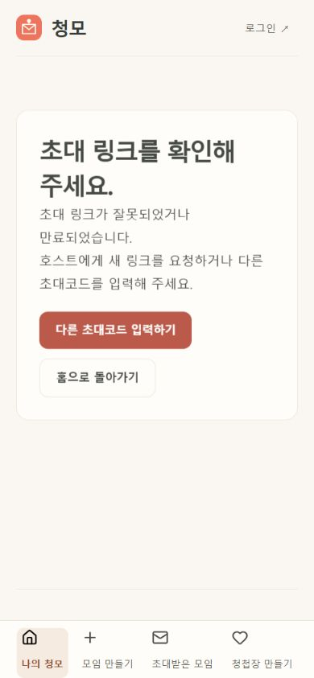
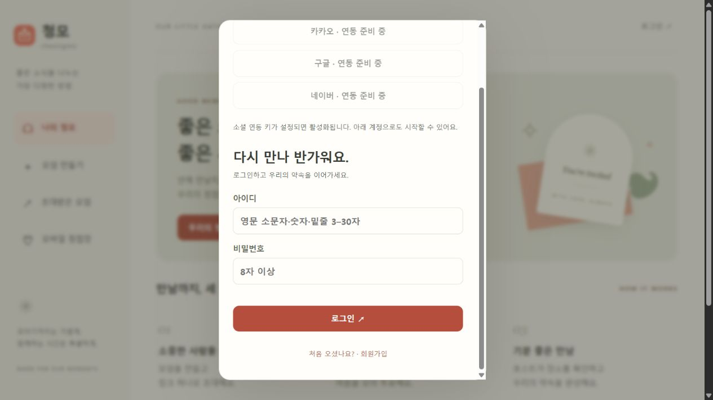

# 호스트·게스트 UX/UI 검증 보고서

검증일: 2026-10-13. 로컬 Spring Boot·PostgreSQL 서비스와 내장 브라우저를 사용했다. 모바일 390×844 중심의 시나리오 검증이며 실제 사용자 대상 사용성 조사나 실기기 검증은 아니다. GrillMe의 사실 점검·용어 검토와 별도 읽기 전용 코드 검토를 병행했다.

## 역할별 흐름과 결과

| 역할 | 시나리오 | 변경 전 결과 |
|---|---|---|
| 호스트 | 로그인된 호스트 → 새 모임 작성 → 생성 | 성공. ‘모임 만들고 초대하기’가 초대 화면으로 이어지지 않음 |
| 호스트 | 일정·장소 후보 추가 | 성공. 새 모임의 빈 후보 안내도 제공 |
| 호스트 | 개인 초대 생성 → 코드·링크 확인 | 성공. 대문자·숫자 6자리, 재전송 버튼 제공 |
| 호스트 | 단체 링크 생성 | 성공. 개인 초대와 별도 영역이나 새로고침 후 공유 링크 소실 |
| 호스트 | 계정 로그인 양식 → 로그인 완료 | 개선 후 demo_host 계정으로 성공. 카카오·구글·네이버는 모두 연동 준비 중 |
| 호스트 | 성수 빠른 선택 → 장소 검색 → 기타 직접 입력 | 개선 후 실제 장소 15개 표시. 기타 선택 시만 직접 입력 노출 확인. 네이버 후기 미연결 안내 확인 |
| 호스트 | 예약 상태·메모 기록 → 일정·장소 확정 | 성공. 예약 확인과 모임 확정이 분리되어 있으며 투표 비활성화 |
| 게스트 | 개인 링크 → 이름 입력 → 가입 없이 참여 | 성공 |
| 게스트 | 일정·장소 선택 → 투표 저장 → 재접속 | 성공. 이어서 참여하면 기존 이름과 두 선택 유지 |
| 게스트 | 잘못된 코드 → 오류 안내 → 소문자 유효 코드 | 성공. 오류를 안내하고 유효 코드를 대문자로 정규화 |
| 게스트 | 동일 세션에서 단체 링크 재참여 | 실패한 UX. 기존 신원·투표는 유지하지만 다시 입력한 이름이 무시됨 |
| 게스트 | 청첩장 만들기 메뉴 | 호스트 전용 오류 화면으로 연결되는 불필요한 동선 |
| 공통 | 잘못된/만료 초대 링크 | 코드 재입력·홈 이동 동선 부족(코드 및 후속 브라우저 검증 대상) |
| 공통 | 확정된 약속에서 방문 정보 찾기 | 요약에 확정 장소 주소·지도·전화·예약 메모 누락(코드 확인) |

로컬에 합성 모임 **UX 역할 검증 20261013**, **UX 초대 동선 검증 20261013**, 합성 게스트 **UX 개인게스트 / UX 단체게스트**와 예약 메모를 만들었다. 실제 초대 전송·예약·소셜 가입은 수행하지 않았다. 기존 사용자 모임은 변경하지 않았다. 재접속 시 페이지에 초대 확인 화면이 다시 나오는 것은 현재 동작이며, 자동 신원 전환으로 바꾸지 않는다.

## 발견 사항과 개선 우선순위

| ID | 우선순위 | 재현·영향 | 개선 |
|---|---|---|---|
| UX-01 | P1 | 기존 게스트의 단체 링크 preview가 항상 joined=false. 이름을 요구한 뒤 기존 이름으로 참여 | 현재 세션의 해당 모임 참여 여부를 preview에 반영하고 이름 없는 재접속을 서버에서 허용. 신규 참여 이름 검증 유지 |
| UX-02 | P2 | 게스트 하단·데스크톱 메뉴에 호스트 전용 제작 버튼 노출 | 게스트 메뉴에서 모임 생성·청첩장 제작을 제외하고 게스트 안내 문구 사용 |
| UX-03 | P2 | 모임 생성 CTA의 ‘초대하기’ 약속과 실제 동작 불일치 | 생성 완료 후 초대 대화상자 연결 |
| UX-04 | P2 | 개인 초대 안내가 코드 없이 이름만으로 참여한다고 설명 | 코드 또는 전용 링크 확인 후 이름 입력임을 명시 |
| UX-05 | P2 | 오류 링크 화면에서 다른 초대코드 입력·홈 복귀 선택 없음 | 두 복구 동선 추가 |
| UX-06 | P2 | 확정된 장소 정보를 과거 후보 목록에서 찾아야 함 | 확정 요약에 주소·지도·문의전화·예약 메모 추가 |
| UX-07 | P2 | 단체 공유 링크는 메모리에만 존재. 재접속하면 활성 초대가 있어도 공유 불가 | 현재 보관 한계를 생성 직후 명시. 서버에서 재조회 가능한 링크 보관은 후속 설계 항목 |
| UX-08 | 배포 전 확인 | 소셜 로그인 세 제공자가 모두 연동 준비 중 | 운영 키·콜백 주소 연결 후 실제 제공자별 로그인·취소·실패·재접속 검증 필요. 이번 변경에서 외부 계정 설정은 수행하지 않음 |
| UX-09 | P1 → 개선 완료 | 일반 회원이 아이디·비밀번호를 잊으면 사이트에서 복구 불가 | 이메일 인증·아이디 안내·일회성 비밀번호 재설정·기존 회원 연락처 등록 구현. Brevo 실제 발송·수신 확인. [계정 복구 안내](account-recovery.md) |

GrillMe 검토 질문: 호스트는 다음 준비 작업을 알 수 있는가? 게스트에게 운영 기능을 제안하는가? 이미 참여한 사람이 다른 사람으로 바뀐다고 오해하는가? 확정은 예약 완료를 뜻하는가? 링크를 잃었을 때 이름만으로 신원을 복구하는가? 현재 용어와 정책을 유지하면서 화면과 서버 동작의 불일치를 고친다. 사용자 요청에 따라 보고서 작성 후 위 일반 개선을 진행한다.

## 근거와 검증 제한

- 브라우저 변경 전 기록: `artifacts/role-host-before.png`, `artifacts/role-guest-before.png`, `artifacts/role-group-reentry-before.png`.
- 코드 근거: `app.js`의 accountView/detail/guestEntry/shareDialog/new-form, `GroupInvites.java`의 preview/Entry/enter.
- 기존 자동 테스트는 역할 권한·투표 분리·확정 후 투표 차단·재개방·CSRF·초대 취소/만료를 포함한다. 브라우저에서는 실제 회원가입, 카카오·구글·네이버 로그인 완료 및 카카오톡 최종 전송을 검증하지 않았다.
- 현재 실제 네이버 후기 키는 미연결이다. 장소 검색은 예약 가능 여부나 후기 품질 검증과 구분한다.

## 개선 후 결과

**UX-01~06 적용 완료, UX-07 안내 보강, UX-08 환경 미연결로 미검증.**

- 기존 세션으로 단체 링크를 다시 열면 이름 입력이 사라지고 **이어서 참여하기**를 제공한다. 재참여 후 개인 게스트 이름, 투표 2개, 참여 인원 유지. 별도 이름으로 새로 참여한 단체 게스트는 투표 0개와 개인 재접속 URL을 받아 신원이 분리된다.
- 게스트의 모바일·데스크톱 메뉴에서 모임 생성·청첩장 제작을 숨기고 안내 문구를 투표 중심으로 변경했다. 호스트는 제작·장소·관리 기능을 유지한다.
- 새 모임 생성 후 **친구들을 초대해요** 대화상자로 바로 연결됨을 브라우저에서 확인했다. 개인 초대 안내를 코드/전용 링크 확인 후 이름 입력으로 수정했다.
- 잘못된 링크에서 **다른 초대코드 입력하기**로 유효 코드 확인·기존 게스트 참여까지 복구했다. **홈으로 돌아가기** 링크도 제공한다.
- 확정 요약에 선택된 장소의 주소·지도·문의전화·예약 메모를 표시했다. 합성 지도 장소로 확정해 지도 URL을 확인하고 게스트 화면에서도 노출을 확인했다. 투표 다시 열기의 확인 대화상자와 후보·투표 유지, 재확정 후 입력 잠금을 검증했다.
- 단체 링크의 서버 원문 보관은 현재 해시 전용이다. 원문 암호화 보관·호스트 재조회와 이전 링크 처리 정책은 후속 개선으로 남긴다. 단순 UI 수정으로 링크가 복원된다고 주장하지 않는다.
- 자동 테스트 **48개 통과**, JS 구문 검사와 로컬 패키지 빌드 성공. HTTP 회귀 테스트로 익명 신규 참여의 빈 이름 거부, 로그인된 해당 모임 게스트의 joined=true preview, 이름 없는 재접속, 이름·투표·인원 보존을 확인했다.
- 모바일 390×844에서 문서 너비 375px / scrollWidth 375px로 가로 넘침 없음. 브라우저 콘솔 오류와 확정·복구 화면 검증 기록은 아래 이미지에 포함한다. 실기기 카카오톡·iOS Safari·스크린리더 검증은 별도 필요하다.

## 화면 근거

### 단체 재접속: 변경 전

### 단체 재접속: 개선 후

### 초대 링크 오류 복구: 개선 후

## 회원가입 후 아이디·비밀번호 찾기 추가 점검

사용자 후속 요청에 따라 로그인·회원가입 화면과 Accounts/SecurityConfig/전체 migration을 점검했다. **현재 계정 복구는 미구현**이다. 기존 기능의 오동작이 아니라 화면·API·본인 확인 수단이 모두 없는 상태다.

| 항목 | 확인 결과 | 영향 |
|---|---|---|
| 로그인 화면 | 아이디·비밀번호와 회원가입 전환만 있음. 찾기 버튼 없음 | 정보를 잊으면 복구를 시작할 수 없음 |
| 가입 정보 | 이름·아이디·비밀번호만 수집 | 본인을 확인할 이메일·휴대전화가 없음 |
| 저장 데이터 | username/display_name/password_hash. 복구 연락처·인증 상태·복구 토큰 없음 | 기존 회원에게도 복구 연락처를 등록해야 함 |
| 서버 | register/login/me는 존재. 아이디 찾기·비밀번호 재설정 API 없음 | UI 버튼만 추가해도 실제 복구는 불가능 |
| 비밀번호 저장 | BCrypt로 해시 저장 | 원래 비밀번호를 조회하는 기능이 아니라 새 비밀번호 설정 절차가 필요 |
| 소셜 회원 | 제공자 계정으로 로그인하는 구조. 세 제공자 모두 현재 연동 준비 중 | 서비스 자체 비밀번호 찾기와 제공자 계정 복구를 구분해야 함 |
| 게스트 | 가입 없는 개인 초대코드·링크 기반 | ID/PW 찾기가 아닌 호스트의 초대 재전송 경로 사용 |

### 후속 구현 기준

1. 일반 회원 가입·계정 설정에서 복구 이메일을 등록하고 인증한다. 기존 회원에게는 로그인 가능한 동안 복구 이메일 등록을 안내한다. 이메일 발송 서비스 연결이 필요하다.
2. 로그인 화면에 아이디 찾기·비밀번호 재설정 진입을 제공한다. 검증된 이메일로 소유 확인을 거친 뒤 복구하며, 화면 응답으로 다른 사람의 가입 여부를 노출하지 않는다.
3. 비밀번호 재설정 링크는 제한된 유효기간과 일회성 사용, 서버 토큰 해시 저장, 요청 횟수 제한을 갖춘다. 재설정 후 기존 세션 처리와 성공·실패·만료 안내를 정의한다.
4. 이름만으로 아이디 공개·비밀번호 변경을 허용하지 않는다. 기존 계정에 검증된 복구 수단이 없는 경우를 별도로 다룬다.
5. 회귀 검증은 없는 계정·미인증 이메일·만료/사용된 링크·중복 요청·변경 후 로그인·다른 계정 변경 차단을 포함한다.

이메일 기반 복구는 권장 구현안이며 이번 점검에서 DB·가입 정책·외부 메일 설정을 변경하지 않았다. 이번 후속 작업에는 코드 변경이 없어 테스트를 다시 실행하지 않았다. 직전 자동 테스트 48개는 가입 검증·중복 아이디 거부 등을 포함하지만 계정 복구 검증을 의미하지 않는다.

후속 구현: 사용자 요청으로 위 계정 복구를 구현하고 Brevo SMTP를 연결했다. 자동 테스트 54개와 실제 발송·Gmail 수신 확인 완료. 위 문단은 구현 전 점검 기록이며 현재 동작은 [계정 복구 안내](account-recovery.md)를 따른다.

