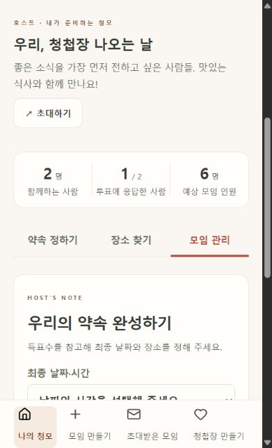
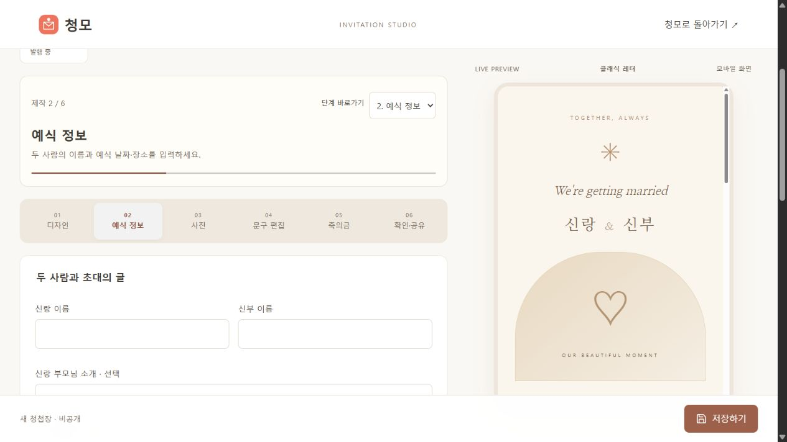
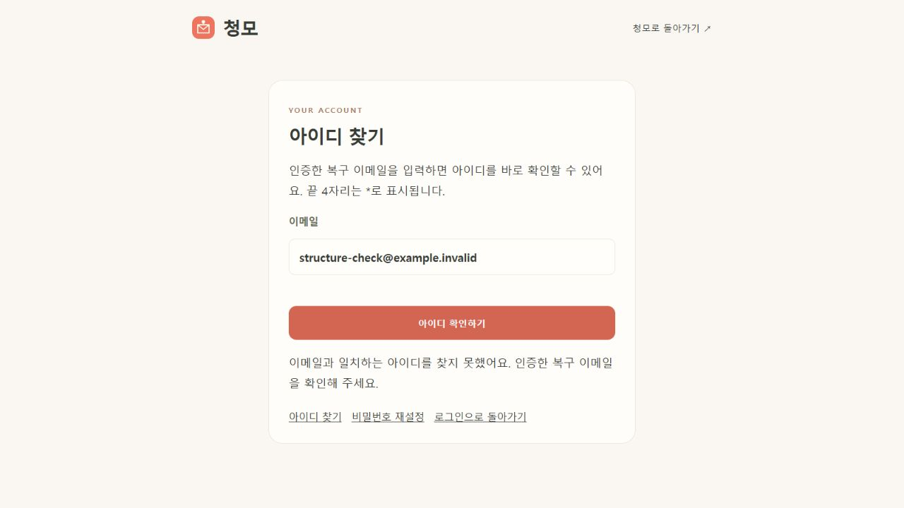

# 구조 리팩터링 검증

2026-10-13 요청: 검토한 기능별 View / Controller / Service / Repository / DTO 방향으로 수정.

## 변경

기능별 account·meeting·guest·invitation·place 패키지, 공통·설정 패키지로 분리했다. 한 파일에 있던 Controller를 분리하고, SQL과 DB 행 변환은 7개 Repository로 옮겼다. 계정 복구 메일 큐는 Controller에서 서비스로 이동했다. 일반 호스트 가입의 생성 정책은 AccountService에서 검사하고, 내부 게스트·소셜 계정 생성과 기존 로그인 호환을 유지한다.

요청 DTO를 dto 패키지로 이동하고 계정·복구·모임·청첩장 주요 응답을 record로 명시했다. URL과 JSON 필드 이름은 유지한다. 내부 행·게스트 응답·외부 검색의 일부 Map은 남아 있다. [구조와 개발 기준](architecture.md)에 범위를 설명한다.

청모 상태·화면 렌더링·가입 화면을 JS 모듈로 나누고 세 화면의 API·CSRF 처리와 출력 이스케이프를 공통화했다. 청첩장 편집기 기능 모듈과 기존 화면 진입 URL은 유지한다.

## 검증

실제 PostgreSQL cheongmo_test DB에서 전체 자동 테스트 **60개 통과**(실패·오류 0). 기존 58개 회귀 테스트에 계층 의존성 검증 2개를 추가했다. 계정 복구·세션 폐기·기존 비밀번호 호환·게스트 권한·초대 충돌 재시도·투표·확정·청첩장 저장 버전·검색 캐시를 검증했다.

로컬 패키지 빌드와 재시작 완료. 새 공통·상태·View 모듈 5개의 익명 HTTP 접근 200 확인. 전체 static JavaScript 파일의 구문 검사 통과. Service에는 JdbcTemplate 필드나 SQL이 없으며 Repository로 이동했다.

브라우저에서 체험용 호스트 로그인, 모임 목록·상세·후보·장소 선택·모임 관리, 청첩장 목록·편집 단계 이동, 가짜 이메일로 아이디 조회 실패 안내를 확인했다. 테스트 중 분리한 공통 유틸의 구문 오류를 발견하여 수정·전체 JS 재검사·재빌드 후 화면을 다시 검증했다. 수정 이후 추가 오류가 없고 새 편집·계정 탭의 오류 로그는 비어 있다.

브라우저에서는 기존 모임·청첩장을 읽고 편집 단계만 이동했다. 가입·저장·발행·인증 메일 발송·비밀번호 변경은 제출하지 않았다. 데이터 변경 경로는 별도 테스트 DB의 자동 테스트로 검증했다. 로컬 앱 데이터·설정과 DB 마이그레이션은 변경하지 않았다.

